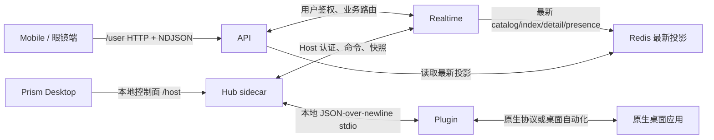
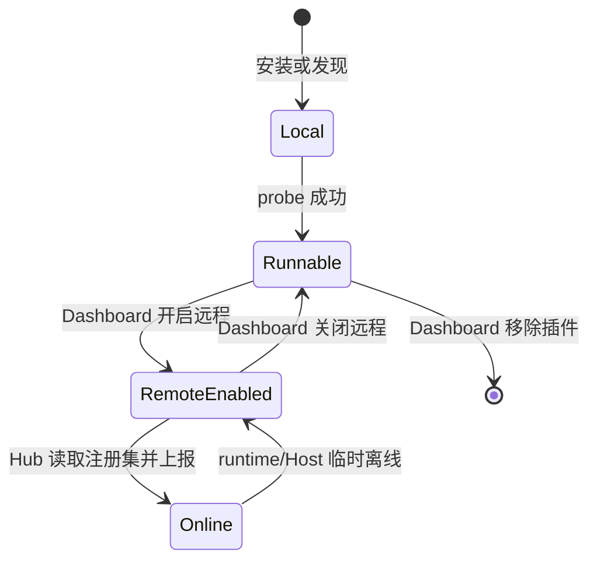

# 01. 整体架构与公共契约

更新时间：2026-08-01

## 1. 产品边界

Prism 让用户通过 Mobile 远程查看并继续本机桌面应用中的会话，同时通过 Prism Desktop 管理本机 Hub 和 Plugin。Hub 是 Desktop 托管的 sidecar；Plugin 是与具体原生应用交互的唯一所有者；API 与 Realtime 提供账号、路由和最新状态投影，不保存正文副本。

当前范围：

- Mobile 查看已开启远程的 Host Plugin、其会话列表和当前详情，读取正文，向已有会话发送、以首条消息启动新会话、控制、打断和审批。
- Prism Desktop 登录并绑定当前 Host，管理本地 Plugin，开启/关闭远程，以及查看本机诊断状态。
- Desktop 打开时启动唯一 Hub sidecar，Desktop 退出时停止它；Hub 托管 Realtime、Plugin runtime 与 watcher，维护本地会话 binding，向 Realtime 上报轻量快照并执行远程命令。
- Plugin 读取和控制具体原生应用。

当前不做：正文云端长期存储、手机端事件历史回放、Dashboard 远程会话页、以旧缓存或轮询代替实时状态流。

## 2. 组件与数据方向



职责边界：

| 组件 | 写入权 | 不负责 |
| --- | --- | --- |
| Mobile | 本地页面状态与用户意图 | 推导桌面当前值、保存正文主副本 |
| Prism Desktop | 本地控制面用户操作 | 替代 Hub 保存远程开关、查看远程正文 |
| API | 账号级持久化、归属校验、流连接和快照聚合 | 在线读取桌面补 Redis、编排桌面状态机 |
| Realtime | Host 通道、命令转发、最新投影与 changed 通知 | 直接服务 Mobile、保存正文 |
| Hub | Plugin 进程、注册集门禁、binding、命令路由与快照上报 | 账号级 fan-out、HTTP 状态流 |
| Plugin | 原生会话、桌面操作、live watcher、正文读取 | 云端账号、远程开启持久化 |

## 2.1 本机常驻服务

Prism Desktop 是唯一对用户公开的本机生命周期 owner。打开 Desktop 时由它启动同包 Hub sidecar；关闭窗口仅隐藏到托盘，只有托盘“退出”或应用 Quit 才停止 sidecar。安装程序不得注册 LaunchAgent、`systemd --user` 或 Task Scheduler；Desktop 第一次启动会尽力卸载旧的用户级服务并接管遗留 Hub，防止两个生命周期 owner 并存。

`prism-sidecar sidecar` 是 Desktop 私有进程协议，要求 `PRISM_DESKTOP_MANAGED=1`，不在公开 CLI 帮助或 PATH 中出现。没有任何面向用户的 Prism 命令；Hub 健康接口仅供 Desktop WebView/诊断读取，不能被解释成另一套用户管理入口。

## 3. 统一对象与身份

| 对象 | 对外标识 | 定义 |
| --- | --- | --- |
| Host | `host_id` | 已绑定到账号的一台桌面设备。 |
| Plugin | `plugin_id` | 一个本地可安装、发现和运行的插件包。 |
| Host Plugin | `(host_id, plugin_id)` | 某台 Host 上已开启远程的 Plugin，也是远程产品的唯一对象。 |
| Conversation | `conversation_id` | Plugin 暴露给远程继续使用的 canonical 会话。 |
| Native session/thread | 不对外 | Plugin 操作原生应用所需的私有标识。 |

不得在新的 HTTP、NDJSON、Realtime、Dashboard 或 SDK 公共协议中使用 `agent_id`、`local_agent`、`agent_instance_id` 或 `host_id:plugin_id` 拼接身份。Hub 内部 adapter 名、旧数据库字段和原生 ID 都不是对外身份，也不能反推对外身份。

Mobile 点击新建必须先打开桌面的真实匿名草稿，并由 API/Realtime/Hub 同步返回一个仅在该草稿生命周期内有效的 opaque `draft_id`。`draft_id` 不是、也永远不会成为 `conversation_id`：它不得进入 `remote_selection`、首页 index/catalog、canonical binding、已有会话详情流或 native/canonical 映射。草稿首发经 `conversation.draft.start` 创建并写入原生会话；Hub 只在收到真实 native session/thread ID、确认首条消息可见并持久化 binding 后，才生成并返回 opaque canonical `conversation_id`。`message_id` 是首发的幂等键，不是会话身份。

桌面前台不再是该匿名草稿、草稿被关闭或无法辨认时，草稿状态固定为 `draft_stale`。Mobile 保留本地未发送文本和已选项目、禁用草稿 controls，并只提供“重新打开桌面草稿”。重新打开明确创建新的桌面匿名草稿和新的 `draft_id`，不搜索、不恢复旧草稿，也不复用旧草稿的 controls。

匿名草稿打开后，Mobile 必须建立仅绑定该 `draft_id` 的瞬态草稿状态流。建流首帧由 Hub 校验当前进程内同一草稿记录并返回最近一次桌面确认的 `draft.snapshot`；Codex foreground watcher 发现该草稿被切走、关闭或无法辨认时，只向仍订阅该草稿的流发送 `draft.stale`。草稿流不写 Redis projection、catalog、index、selection、binding 或 canonical 映射，也不产生会话 detail。首发成功且 API 收到 Hub 已持久化 binding 的 canonical `conversation_id` 后，Mobile 先取消草稿流，再以该 canonical ID 建立普通详情状态流和正文 relay；两类流不得并存。首发失败时仍保持草稿流及本地输入，除非失败码为 `draft_stale`。

## 4. Host Plugin 生命周期

本地 Plugin 生命周期与远程接入生命周期独立：

| 状态 | 真相源 | 说明 |
| --- | --- | --- |
| 已安装/已发现 | 本地插件目录和 manifest | 仅代表本机可以管理该包。 |
| 本地可运行 | Plugin `probe` | 代表 runtime 与原生依赖此刻可用。 |
| 已开启远程 | API Host Plugin 记录存在 | 允许进入远程 catalog、会话上报和命令路由。 |
| 远程在线 | Hub Realtime presence 与 runtime snapshot | 代表当前可服务，不由数据库伪造。 |

首次发现或安装默认未开启远程。开启远程创建 Host Plugin 记录；关闭远程删除该记录和该 Host Plugin 的云端投影，但保留本地包及原生会话；移除 Plugin 则先完成关闭远程，再停止 runtime 并删除本地包和本地配置。



## 5. 状态真相源与存储

| 状态 | 真相源 | 写入方 | 存储/投影 | 读取方 |
| --- | --- | --- | --- | --- |
| 已开启远程 Host Plugin 集 | API Host Plugin 记录 | API | API 数据库 | Hub、Dashboard、Mobile |
| 本地 Plugin 安装与 manifest | 本地文件系统 | Hub/Dashboard | Host 本地目录 | Dashboard、Hub |
| runtime 可用性与能力 | Plugin `probe` | Plugin | Hub runtime 状态、catalog | Hub、Dashboard、Mobile |
| 会话轻摘要 | Hub index snapshot | Hub/Plugin watcher | Realtime Redis projection | API、Mobile |
| 当前详情 | Plugin foreground live watcher | Plugin | Hub detail store、Realtime Redis projection | API、Mobile |
| 正文 | 原生会话 `readHistoryStream` | Plugin | 原生应用 | Hub/Realtime/API 流式转发至 Mobile |
| 会话 native/canonical binding | Hub `bridge_sessions` | Hub | Hub SQLite | Hub |
| 用户最近选择 | API `remote_selection` | API | API 数据库 | API、Mobile |

详情中的 `current_model`、`current_reasoning`、`current_permission`、稳定 options、`interactive_controls`、`interactive_surface`、approval、queue、上下文窗口、`run` 和 `primary_action` 是 strict live 字段。只有前台 live watcher 可以写入；会话列表、历史 metadata、TTL 和旧缓存不能补写或伪造这些字段。Codex 的模型、推理、权限只发布 `interactive_controls`，对应的固定 `current_*` 为 `null`、`*_options` 为空数组，以清除旧投影而不允许回退。

### 5.1 交互对象边界

稳定 SDK control 是基础能力：仅当原生应用公开可跨重开的业务 ID 时，Plugin 才发布 `*_options[]` 并接受 `model.switch`、`reasoning.switch` 或 `permission.switch`。除此之外，详情中的四类交互对象不能合并、互相降级或由文案猜测：

| 对象 | 适用范围 | 稳定性与控制入口 |
| --- | --- | --- |
| `interactive_controls[]` | 当前会话 composer 中关闭态可读、可按需打开的动态桌面菜单 | detail 仅含 `{control_id,display_label,current_value,menu_available}`；点击后以 `{kind:"interactive_control",control_id}` 创建 `menu_session`。 |
| `approval` | 原生/App Server 提供稳定 `approval_request_id` 的请求型审批 | 可恢复的原生 request，调用 `approval.resolve`。 |
| `queue` | 原生排队消息及其单条/队列级操作 | 以原生 queue item identity 和当前 action ID 控制。 |
| `interactive_surface` | 当前前台会话可见的短生命周期 dialog/form | 当前完整 snapshot 有效的 `{surface_id,action_id,input?}`，调用 `interactive.surface.apply`。 |

`interactive_surface` 不替代 approval，也不承载排队消息或常驻菜单。它只在 Plugin 能从真实 DOM、ARIA 或 Fiber 得到当前 surface、input 和 action 的唯一运行时身份时发布；原生 thread ID 仅留在 Plugin/Hub 本地，不能进入对外对象。`title` 可以为空，不能以虚构标题补齐；`description` 必须优先取 Desktop 的 ARIA 描述，引用节点不可读时才从当前 dialog 的可见非按钮正文回退，确保风险说明不丢失。Plugin 只发布当前 action 的实际运行时 handler 不含浏览器/外链、剪贴板、桌面路由、系统对话框或 host bridge 副作用的按钮；未发布 action 的原始 DOM 索引只在 Plugin 内部用于回点，不能暴露给 Mobile 或用固定顺序重建。前台从 A 切至 B 时，Plugin 和 Hub 必须立即从 A 的 detail 清除该 surface，即使旧 overlay 短暂仍在桌面 DOM；不得迁移给 B，也不得在回到 A 时从旧缓存恢复。只有 A 再次成为前台且 watcher 重新读取到完整真实 surface，才可发布新的 surface。

### 5.2 临时 Action Menu

桌面 popover menu 的读取与执行统一采用短生命周期 `menu_session`，但它不是第五种 detail 交互对象：它只是 `interactive_controls`、`queue` 或 conversation action trigger 的按需读取过程。watcher 只读取关闭态中可直接观察的 owner、direct action 与 `menu_available`/`has_more_actions`，绝不为了列出候选项而打开、关闭或缓存任何 menu。Mobile 点击一个动态 control 或通用“更多”图标后才请求 describe；该请求不写 Redis projection、不经状态流广播。

describe 的 owner 只能是当前 conversation detail 或 draft snapshot 声明的 `{kind:"interactive_control",control_id}`、当前 canonical conversation，或当前 `queue_item_id` 对应的原生队列项。Plugin 在同一 CDP 临界区临时注入仅本次事务有效的 `opacity:0` 样式，打开该 owner 的真实 menu，读取 DOM/ARIA/Fiber 层级路径、候选顺序和结构指纹后关闭并清理样式。返回的 `menu_session_id`、`entry_id`、label 和 available 均为 opaque runtime 数据；label 只用于原样显示与精确 fingerprint，不参与语义识别、语言词典、模糊匹配或 fallback。

Mobile apply 时携带 `menu_session_id + entry_id`。Plugin 必须再次透明打开同一 owner 的 menu，重建完整路径和指纹并精确校验目标唯一存在后才点击；owner、路径、候选集合、目标或可用性任一变化均返回 `control_target_stale`（草稿统一返回 `draft_stale`），不改投相近项。session 仅保存在 Hub/Plugin 内存，创建后 2 分钟不可续期，并绑定完整 subject：canonical conversation 或 `draft_id`；过期、Hub/Plugin 重启、桌面前台改变或 menu 无法唯一重建同样失败。Mobile 对一次 `control_target_stale` 只重新 describe 同一个 control 并重新展示候选项，要求用户再次确认，绝不重放旧 `entry_id`。所有成功仍以 watcher 的新 detail、draft snapshot 或正文收敛。

“能定位”不等于“可远程发布”。每个 menu action 还必须同时满足：绑定唯一当前 owner；不会触发桌面侧边栏、路由、项目/设置、系统文件选择器、剪贴板、外部链接或其他仅桌面可见的副作用；且结果可由 `queue`、`composer`、`interactive_surface`、index/title、正文或 run 的新快照观察到。无法从真实 DOM/Fiber 得到 action identity，或无法声明可观察结果通道的项，一律不返回给 Mobile。桌面“在侧边栏打开”、复制、打开目录/链接、桌面新建会话等没有手机等价物，必须省略，不能先执行再尝试回滚。

新对话不使用 `menu_session` 的普通 action 语义。它始终是独立的 `conversation.draft.open`：Plugin 点击原生新建入口后，只有确认出现新的匿名 `client_thread_id` 与空 composer 才返回 `draft_id` 和实际 controls；首发成功后才建立 canonical conversation binding。全局与项目内新建都必须由真实 DOM/Fiber identity 定位并以实际新草稿验证，找不到唯一入口时返回 `draft_open_unsupported`；禁止使用快捷键、固定第几个按钮或中英文文案 fallback。

## 6. 状态流和正文读取

Mobile 有两条状态流：应用前台常驻的 `scope=home` 和当前详情页的 `scope=conversation`。每条流的首个**状态**事件和后续变化都是完整最新快照，客户端直接覆盖。没有 cursor、重放、Redis Stream、outbox、定时轮询或 burst refresh。

状态流的连接身份分为两层：`X-Prism-Client-Instance-Id` 是 Mobile 首次安装生成并持久化的安装级随机 ID；`X-Prism-State-Stream-Id` 是每次 HTTP 连接新生成的随机 ID。API 以 `(account_id, client_instance_id, scope, host_id, plugin_id, conversation_id/draft_id)` 作为逻辑流键：同一安装、同一逻辑目标的新连接原子替换旧连接；不同安装即使观看同一会话也可并存。一个账号最多 16 条活跃流。API 使用 Redis 维护十分钟租约和逻辑键到 owner Pod 的记录，新旧替换、显式关闭和租约到期均通过 Redis Pub/Sub 精确通知 owner Pod 清理本地 subscriber、正文 relay 或 draft watch；旧流的 `finally` 只是幂等兜底，不能删除后来替换的新租约。

HTTP 建立后 API 先注册订阅、异步读取首个 state snapshot；`stream.open` 与首个产品事件（`home.snapshot`、`conversation.snapshot` 或 draft state）必须写入同一 NDJSON batch 并只 flush 一次，不能先单独 flush 传输事件。首个产品状态在 5 秒内未获得时，batch 依次包含 `stream.open`、`stream.error` 和 `stream.close`；Mobile 保留上一份已渲染状态并按重连策略新建连接。首个 snapshot 使用独立有界 executor；后续 scope refresh 与账号首页 projection 重建也必须分别使用独立有界 executor，后台 projection 的慢数据库读取不得占用首快照队列。API 每 20 秒发送 `stream.heartbeat`；十分钟租约到期发送 `stream.close{reason:"lease_expired"}`，Mobile 无感重连。`stream.heartbeat`、`stream.error` 和 `stream.close` 都是传输事件，绝不能覆盖已经收到的状态快照或正文。若真实入口仍不能透传小批量，API 可临时通过动态 `wire-padding-bytes` 做阈值 A/B；它不是产品协议，也不能替代支持响应流的入口。

`home.snapshot` 的首帧来自按账号保存的完成态 Redis projection，而不是在每条 HTTP 流中同步拼接多份数据库/Host Redis key。Realtime changed 以及 selection、unread、Host Plugin 生命周期变化只触发该账号 projection 的异步重建；重建成功后覆盖 key 并刷新活跃首页流。故手机强制关闭后建立的新流与桌面是否产生下一条消息无关：只要 Redis 可用，它必须立即得到最近一次完整首页投影；冷启动源拼装与投影写回不能阻塞已有投影的首帧。

`scope=conversation` 流同时承载 detail 和正文事件，但 `conversation.snapshot` 本身不含正文。进入会话后，API 经 Realtime、Hub、Plugin 建立一个 `readHistoryStream`：API 的 `prism.remote-state-stream.history-turn-limit` 是唯一产品窗口（默认 `5`，范围 `1..20`），作为内部 `limit` 传给 Hub 和 Plugin。Plugin 先按完整 turn 异步 yield 最新 turn（第一条必须是用户输入），再按最新到最旧的顺序 yield 至多 `limit - 1` 个更早 turn；Mobile 首个 turn 立即放在底部，后续历史逐个 prepend，并仅以 20 turn 作为独立资源保护上限。每个 turn 由同一用户输入和对应 assistant 输出组成，不能按单条 message 截断。

正文事件固定为 `conversation.messages.page.begin`、`conversation.messages.turn`、`conversation.messages.page.end`。每个事件固定带本次连接的 `body_stream_id` 与 `page_id`。`turn` 固定带稳定 `turn_id`、原生顺序 `order_key`、同一 turn 内单调 `revision`、`source`（`initial` / `live`）、`operation`（`append` / `replace`）和完整 `messages[]`。消息类型只允许 `text` 或 `progress`；progress 是当前 assistant 的单个过程单元，含 `status`、时间及按桌面顺序排列的 `steps[]`。同一运行中 turn 的新内容使用 `replace`，终态 replacement 保留 completed/failed progress 与最终 assistant text；新用户输入或此前未出现的新完成 turn 使用 `append`；初始窗口内的更早历史同样作为 `initial/append` 到达，Mobile 以 `order_key` 插入正确位置。Mobile 只接受当前 `body_stream_id` 下相同 `turn_id` 的更高 revision，并以 `order_key` 保持顺序。

Plugin 建立 history stream 时必须先注册正文 watcher 并记录原生历史高水位 `H`，再读取不晚于 `H` 的最新/历史 turn；`H` 之后的变化暂存为 live 事件。首个最新 turn（或明确的空页）写入流后，才按顺序释放暂存 live 事件与更早 history 事件。这样初始读取期间桌面新建消息不会丢失或插入历史中间。空会话进入后若桌面产生首条消息，该消息是 `live + append`；若已有最新 turn 后产生新 turn，则同样 append；同一运行中 turn 只 replace。

正文没有上拉分页、cursor 或 offset；每次重连以当前服务端窗口（默认最多 5 turn）收敛。手机不得调用旧的 `messages_signature -> GET /messages` 自动链路；兼容接口在迁移期结束后删除。

`progress.steps[]` 是正文的唯一过程内容，按桌面原始顺序保存 `assistant_text`、`tool`、`tool_result`、`status`。实现不得将多个 assistant 文本合并为 progress 的 `content`；工具必须提供可读 `title` 和可展开的 `detail`。无显式状态的 Codex `function_call_output` 只有包含原生 `Process running with session ID` sentinel 时才为 `running`，其他输出默认 `completed`，不得根据任意自然语言中的 running 猜测。运行中直接按顺序显示各片段，完成后 progress 只显示可展开摘要和最终 assistant text。Mobile 离开详情、切换详情、退后台或主动重连前，必须 best-effort 调用 `DELETE /user/remote/state-streams/{state_stream_id}`，再取消本地 HTTP Call。API 鉴权后关闭完整身份匹配的 state subscriber，并同步转发该 subscriber 拥有的 `conversation.history.cancel` 或 `conversation.draft.unwatch`；关闭幂等，已结束或不存在的流也返回成功。该通用关闭是正文 relay 的唯一正式生命周期入口；旧的 body-stream DELETE 已删除。若 close 先于异步 history stream 到达，Hub 仍须登记完整身份的已取消短期 tombstone 并拒绝迟到 relay。详情 HTTP 流写入失败时的 API `finally` 只保留异常断链补充。桌面前台会话切换不构成取消条件，Mobile 继续展示旧会话时流保持连接并以 stale detail 表示桌面状态。

## 2.8 Agent 额度投影

会话 token/context 使用量与账号额度是不同对象。`context_window_*` 只表示当前会话的上下文窗口；账号额度只允许出现在 Host Plugin 的 agent 级只读 `usage` 投影，不能塞入某个 conversation detail、正文、队列或 run。

Codex 的唯一正式来源是本机 Codex App Server：Plugin 启动独立的只读 App Server client，完成协议初始化后调用 `account/rateLimits/read`，并监听 `account/rateLimits/updated`；可选调用 `account/usage/read` 取得累计/日 token 统计。该 client 不 attach、start、send、interrupt 或控制任何 thread，不读取、转发或刷新 ChatGPT token，不调用有副作用的 `account/rateLimitResetCredit/consume`。Codex Desktop UI、rollout 的 `token_count.info.rate_limits` 与 CDP DOM 都不是额度真相源。App Server 可执行体必须复用桌面已登录上下文：macOS 按序解析桌面 app 内置二进制（`Codex.app`/`ChatGPT.app` 的 `Contents/Resources/codex-cli/bin/codex`（2026-09 桌面版新布局，wrapper 转发到 `codex-cli/CodexCLI.app`）或旧布局 `Contents/Resources/codex`），复用 `~/.codex/auth.json`；PATH/npm CLI `codex` 不共享桌面登录态，会返回 `-32600 chatgpt authentication required`，不可作为默认来源（仅作 Win/Linux 内置布局未验证时的回退）。

统一公共投影固定为 `usage={source,status,updated_at,plan_type,limit_id,limit_name,windows[],credits,token_usage}`。`status` 只允许 `available`、`unavailable`、`stale`；无本机登录、App Server 不支持、读取失败或字段为空时保留 `null`/空数组并明确状态，绝不以历史值伪造实时额度。每个 `windows[]` 固定为 `{slot,used_percent,resets_at,window_duration_mins}`，`slot` 仅为 App Server 的 `primary`/`secondary` 原始位置和排序，不具有“5 小时”或“周”语义。终端优先显示 backend `limit_name`；窗口标题只能由非空 `window_duration_mins` 通用格式化，例如 `300` 分钟显示为“5 小时窗口”，`10080` 分钟显示为“7 天窗口”。没有时长时只显示中性“额度窗口”。`credits`、`plan_type`、`rate_limit_reached_type`、spend-control 和 token usage 均按 App Server 原始可用字段投影，不能补零或猜测套餐。

Plugin 首次 remote-ready、App Server 重连和收到额度 notification 时发布新的 plugin-level usage snapshot。没有 notification 时不以高频轮询伪造实时性；Mobile 用户显式刷新 agent 信息时可请求一次新的只读 read。Hub/Realtime/API 只存储并透传最近完整 usage 投影，按 Host Plugin 身份路由；Mobile 在 Agent 信息区展示，不因查看某条会话而改变或重新解释额度。

Realtime 必须先写 Redis 最新 projection，再发内部 `changed` 通知。API 收到通知后按 scope 重读 Redis 再下发。Redis listener 重连后，所有活跃流各下发一次最新快照，以 latest-wins 方式收敛漏失通知；这不是客户端轮询或备用链路。

## 7. 全局返回与认证

所有 JSON 响应和 NDJSON 每一行使用同一外层：

```json
{
  "success": true,
  "code": "ok",
  "message": "",
  "data": {}
}
```

`success` 是外层传输是否成功的布尔值：`code="ok"` 时必须为 `true`，任何非 `ok` code 时必须为 `false`。失败时 `code` 是稳定机器可读错误码，`message` 是面向用户的描述，`data=null`。禁止顶层 `ok`、`accepted`、`error` 或裸数组/对象。

Mobile、Hub 和 Dashboard 的全部 API 业务资源均使用用户登录 token（`X-Account-Token`）；Hub 调用时以本机 `host_id` 作为路径范围。`X-Host-Token` 只用于 Hub 与 Realtime 的 Host 连接和该 WebSocket 协议。两条认证链独立：账户 token 失效会阻断 API 业务调用和注册集读取；Host token 失效会阻断 Realtime 连接。两者分别刷新后才恢复对应链路。

## 8. 禁止项与待决项

以下不允许成为主链或隐式 fallback：

- 本地 `enabled`、旧注册集、静态 manifest 或标题推断远程开启状态或会话身份。
- 旧 detail、metadata、TTL、Plugin local state 或 index 填充当前 live controls。
- API 状态流在线 query Hub 补 Redis 投影。
- Mobile 首页/详情轮询、按标题/列表位置猜测 pending 会话，或一个 Plugin 不可用时切到另一个 Plugin。
- 为状态问题增加没有本文档定义的缓存层、兼容身份或降级路径。

跨端接口和实现状态以本仓库当前代码及对应公开协议文档为准；涉及 Prism Cloud 或 Mobile 的服务端实现不在本仓库范围内。
