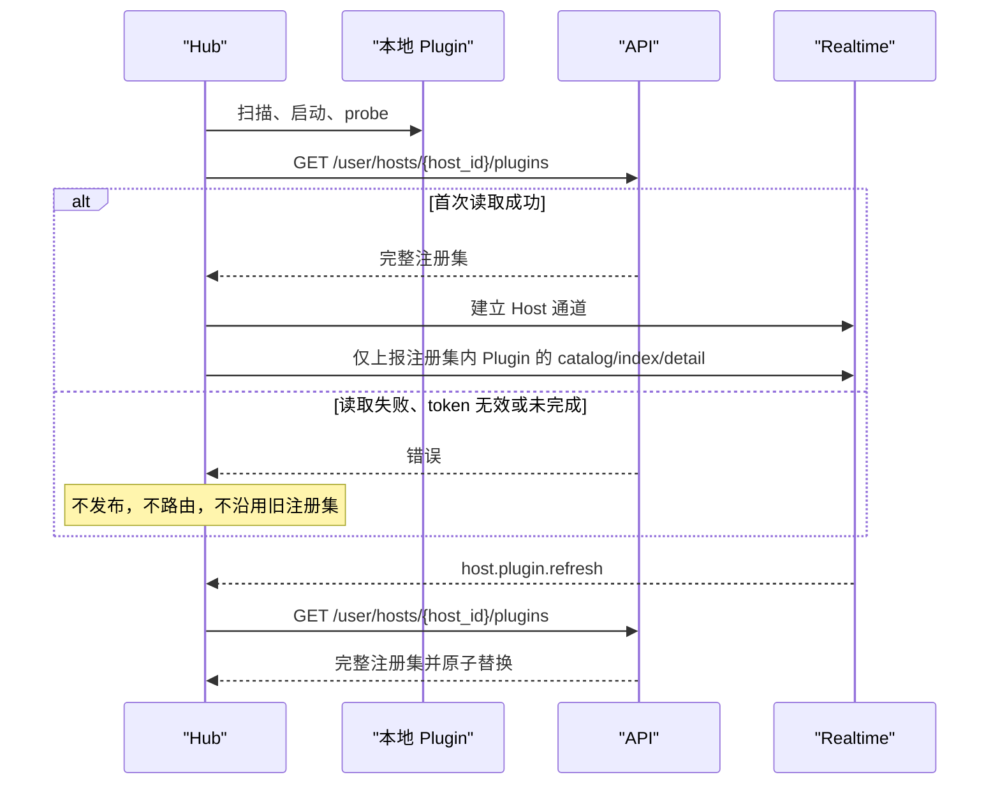
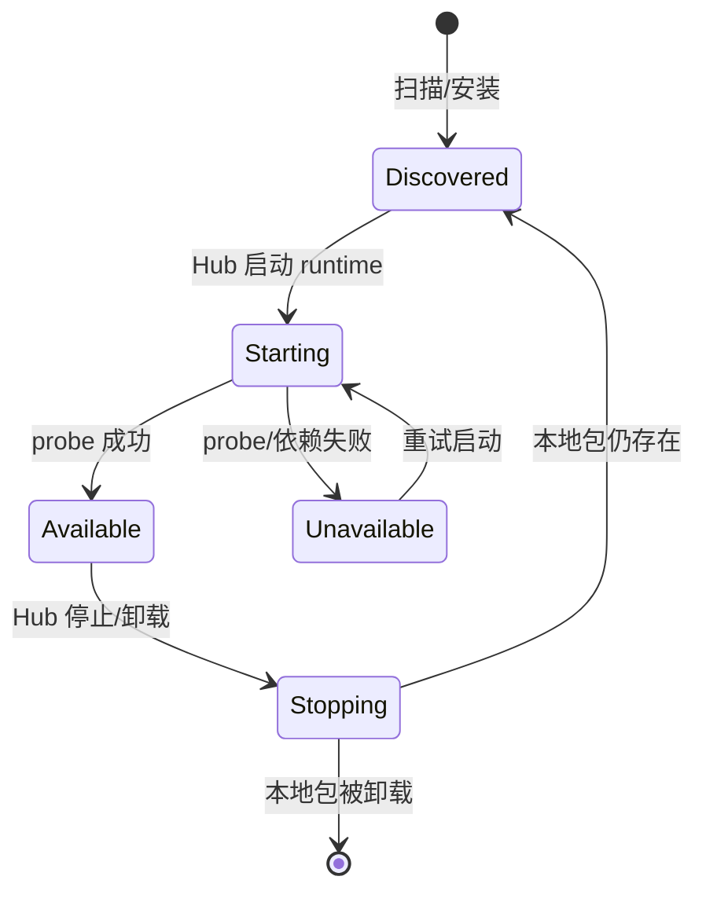
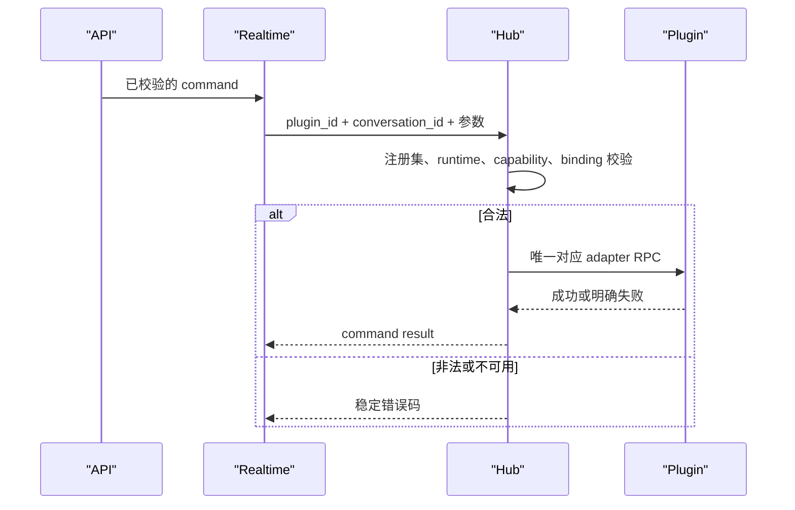

# 04. Hub 功能设计

更新时间：2026-08-05

Hub 是 Prism Desktop 托管的唯一 sidecar 运行时。它在同一进程托管嵌入式本地控制页面、本地 Plugin、Realtime 与 watcher，维护本地 binding、执行远程命令、上报轻量状态，并在远程接入生命周期中执行严格注册集门禁。Hub 不保存正文、不直接服务 Mobile HTTP stream，也不持有账号级状态 fan-out。

## 1. 入口与职责

Hub 的工作由四类入口触发：Prism Desktop 操作、Desktop sidecar 启动或重启、Realtime 连接/命令、Plugin 主动事件。其职责如下：

| 功能 | Hub 必须做 | Hub 不做 |
| --- | --- | --- |
| 本地 Plugin | 扫描、启动、probe、停止、注销和本地诊断 | 自动开启远程 |
| 远程门禁 | 读取完整 Host Plugin 注册集并原子替换 | 用本地配置、旧集合或 manifest 推断远程开启 |
| 会话 | 保存 canonical/native binding | 保存完整正文副本 |
| 命令 | 校验注册集/能力/binding 后路由到 Plugin | 编造桌面成功结果 |
| 状态 | 汇总 catalog、index、detail，发给 Realtime | 直接推送 Mobile 或服务 NDJSON |
| 本地控制面 | 托管 Dashboard、登录态、Hub 服务、日志和诊断 | 作为第二个云端 API |

Prism Desktop 是唯一公开服务生命周期。它启动隐藏的 `prism-sidecar sidecar`，并持有该子进程；关闭窗口只隐藏 Desktop，只有托盘“退出”或应用 Quit 才向 sidecar 发送终止，Hub 按固定停止顺序退出。Hub 不派生独立 daemon，不注册任何平台常驻服务，也不提供用户可调用的 Prism 命令。

健康接口用于 Desktop 读取 sidecar 状态，不代表独立服务管理器。HTTP 403 是 Realtime gateway 拒绝，状态必须为 `gateway_rejected` 并保留网关 detail/request id 供诊断；它不能被映射为 Codex/Plugin 离线。Hub 接收 `SIGINT` 和 `SIGTERM` 后按同一停止顺序退出。

Desktop 每次 sidecar 启动均先执行内置 Plugin 扫描，内置包版本更高时才安装覆盖本地包，然后才创建 Plugin runtime。该动作是 Desktop 分发更新的一部分，不依赖 Dashboard 首次页面请求。Desktop supervisor 以本地 health endpoint 复用已健康的 Hub，避免多窗口互相抢占；停止或重启只处理自己创建的 child。health response 只要已得到完整 JSON body 即可判定，不应等待 HTTP 连接 EOF，且必须支持 chunked body。Desktop 读取 `/api/status` 的上限固定为 512 KiB，不能以任意固定小段截断进程清单后将健康 Hub 误判为离线；超过该上限或 JSON 不完整才视为 probe 失败。

### 1.1 构建环境与区域身份

`dev`、`test`、`prod` 是**构建环境**，只能由 Desktop 打包参数选择，不出现在用户设置、Dashboard 或 Hub 运行时环境变量。构建机从源码内的 `desktop-app/config/deployments.local.properties` 读取当前环境的 CN/Global API、Realtime 和 Panel endpoint，并通过 linker 注入 sidecar 和 Desktop；`PRISM_DEPLOYMENT_CONFIG` 仅用于 CI 或临时覆盖。每份安装包仅含一个构建环境的 endpoint 集。

`cn`、`global` 是账号区域而非构建环境。Hub 只保存一份 SQLite、Plugin 安装和本地 Codex binding；仅云端身份以 `prism.identities["{environment}.{region}"]` 分组保存 `host_token` 与账户/Host token。旧顶层 `prism.host_token` 和 `account` 在首次 Save 时迁移到当前构建环境和区域。切换账号区域先保存旧 identity，再加载目标 identity；登出只删除当前 identity，不能清除另一环境或区域的本地登录态。

## 2. 启动、重连与注册集门禁

API Host Plugin 记录是“远程已开启”的唯一真相。Hub 必须在启动、每次 Realtime 重新连接成功、收到 `host.plugin.refresh` 三个时机以账户 token 调用 `GET /user/hosts/{host_id}/plugins`；读取结果整体替换内存注册集。Host token 仅用于 Realtime 连接与该连接上的 Host 协议，不得用于 API 业务资源。

未完成首次读取、读取失败、账户 token 无效或 Host token 无效时，远程主链不可用：Hub 不发布任何远程 Plugin、不接收任何远程命令，不把本地 discovered Plugin 伪装为远程已开启。账户 token 过期时按账户认证流程刷新并重新读取注册集；Host token 过期时按 Host 认证流程刷新并重连；两者都不能无限携带旧 token 重试。

## 3. 本地 Plugin runtime 生命周期

Hub 以 manifest `id` 作为 `plugin_id` 启动 process/stdio runtime，验证 `probe.PluginID` 与 manifest 一致，并把 runtime 可用性和能力供 Dashboard/Realtime 使用。

停止 Hub 时固定顺序：停止接收新远程命令，关闭 Plugin 订阅，调用 `adapter.close`，终止 runtime。停止 Hub 不删除本地包、Host Plugin 记录或原生会话。Plugin runtime/原生依赖不可用必须有明确原因；Hub 不能以旧 probe 结果伪造可用。

## 4. 会话 native/canonical binding

`bridge_sessions` 是 Hub SQLite 的本地真相，保存：

- `(plugin_id, conversation_id) -> native_session_id/native_thread_id` 的唯一 binding。
- 必要的 receipt/去重与运行辅助记录。

它不是正文库，也不保存 Mobile 最终详情。

Plugin 列出一个尚未 binding 的原生可继续会话时，Hub 生成稳定的 canonical `conversation_id` 并保存 binding。Mobile 新建先处理 `conversation.draft.open`：Hub 只在内存保存 opaque `draft_id -> plugin_id/cwd/desktop draft fingerprint/controls`，不写 binding、不发布 index/catalog/detail、也不写 canonical ID。草稿 fingerprint 仅供 Plugin 与 Hub 在本进程内核验当前匿名桌面草稿；它不是 native/canonical ID，绝不进入 Mobile/API 状态流、Redis、selection 或 SQLite。Codex 使用桌面 React 状态的 `clientThreadId` 作为该 fingerprint；读取为空时拒绝将草稿声明为可控制。`conversation.draft.control` 和 `conversation.draft.start` 先要求 Plugin 验证同一个匿名桌面草稿仍为前台，否则返回稳定 `draft_stale`。`conversation.draft.watch` 用完整 `(plugin_id, draft_id, draft_stream_id)` 校验当前 Hub 草稿记录并注册瞬态订阅，首个结果只能是 `draft.snapshot` 或 `draft.stale`；`conversation.draft.unwatch` 只移除同一订阅。foreground watcher 读取到另一草稿 fingerprint 或原生会话时，只对不匹配的草稿发送一次 `draft.stale` 并移除其订阅；完全无法读取原生会话或草稿 fingerprint 时才报告 `foreground_watcher_unavailable`，不猜测草稿已失效。此事件不写 SQLite binding、Redis projection、catalog、index、selection 或 canonical ID。`conversation.draft.start` 仅在结果同时包含非空 `native_session_id` 或 `native_thread_id`、`receipt.accepted=true`、`receipt.visible=true` 与 `visibility.visible=true` 时，才生成 opaque canonical ID，并在同一数据库事务内写入 binding 与首发 receipt。Hub 将 canonical ID 作为启动成功结果返回，不能生成临时会话 ID，不能按标题、列表新增项、排序或扫描文件猜测目标。

Hub 每个本地 SQLite `DB` 实例固定只使用一个共享连接，并设置 `busy_timeout=10s` 后启用 WAL。Router 再以 `startMu` 串行化同一 Hub 内的 `conversation.start` 和 `conversation.draft.start`。因此 binding、首发 receipt 与 start operation 的完成事务不会和同一进程其他连接争锁；与旧 Hub 或维护命令的短暂外部写锁会等待，而非立刻外泄 `database is locked`。Hub 必须先持久化 `(plugin_id, client_message_id)` 的 start operation，才调用 Plugin；任何重试都只传同一 message ID，Plugin 必须幂等返回同一次 native start 的结果，绝不再次提交首条消息。若持久化仍未完成，外部只可得到明确可恢复终态，不能生成临时 canonical ID。

会话 Header 更多菜单不属于稳定 `actions[]`。Plugin 在关闭态只确认当前 Header 有候选原生 trigger，才发布 `conversation_menu_available=true`；watcher 不得为此打开菜单。Mobile 点击后才 describe `{kind:"conversation"}`，Plugin 透明打开每个当前候选，以 `aria-labelledby -> trigger id` 绑定实际 menu，并且只有**恰好一个**候选产生通过 handler 副作用过滤的远端安全行时才能建 session；零个或多个均返回 `control_target_stale`。Hub 在转发前要求当前 canonical detail 仍为该会话且该字段仍为 true，并把短生命周期 session 绑定到完整 `(plugin_id, conversation_id, owner)`。describe/apply 均可因前台、Header、候选或 handler identity 变化返回 `control_target_stale`；不得使用标题、文案、固定序号或历史候选重试。

`message_id` 是首发和已有会话发送的幂等键。Hub 必须以 `(plugin_id, message_id)` 持久化启动操作，并以短 TTL command receipt 保存已有会话发送的 `accepted`、`visible`、`failed` 或 `pending_confirmation` 结果；相同请求并发或重试只等待/返回同一结果，绝不再次点击桌面发送。已有会话的每次 `chat.send` 都必须在 Router 返回后发送同步 `chat.send.result`，完整关联 `request_id/message_id/plugin_id/conversation_id`，并只携带 `accepted`、`visible`、`pending_confirmation`、`queue_pending`、稳定 `code/message`。`queue_pending` 只代表真实原生 queue click 后 row 的短暂挂载延迟，不是 queue projection；其后仍由 watcher 下发原生 item。`visible` 必须来自 Plugin 对原生 transcript/rollout 新 user turn 的确认，不能以 composer 清空、Stop 出现或 CDP 超时推断。binding 同时保证 `(plugin_id, native identity)` 唯一，防止同一原生会话被并发分配多个 canonical ID。操作记录只用于恢复与去重，不向 API/Mobile 暴露任何暂时会话身份。

### 2.3.1 Agent 额度

Hub 将 Plugin 的 `agent.usage.changed` 视为 Host Plugin 级投影：它不依赖 foreground 会话、不写入 conversation detail，也不触发 index/body watcher。Hub 校验 `plugin_id` 和固定 usage schema 后保存最新完整值并发布 catalog/agent changed；API、Realtime 与 Mobile 不解释 `primary`/`secondary` 的产品含义。Hub 不保存或转发 App Server 的认证材料、原始 account payload、reset credit ID 或任何可执行账户操作。Codex 的 usage reader 是 Plugin 内受管的只读 App Server stdio client；Hub 只接收归一化投影。

`pending_confirmation` 专门表示 Plugin 点击发送后观察到当前前台的真实 `interactive_surface`：Hub 持久化同一 receipt 并返回 accepted，但 `visible=false`；不得插入 `message.user.accepted`、不得启动 run、不得伪造正文或 `approval`。Plugin watcher 发布 surface 后，Mobile 只能原样提交 `interactive.surface.apply`；确认后仍等待原生正文观察，取消则保持消息未送达。该状态的重试必须复用相同 `message_id`，不能再次点击桌面发送。

## 5. 命令路由

API 已完成账号、Host Plugin 归属和远程开启校验后，经 Realtime 把命令送到同一 Host。Hub 必须按以下顺序处理：

1. 注册集包含目标 `plugin_id`。
2. 本地 runtime 存在且 `probe.Available=true`。
3. 所需 capability 已声明。
4. `conversation.start` 没有 `conversation_id`，但必须有非空 `message_id`；其他会话命令有 canonical `conversation_id` 并能找到正确 binding。
5. 调用唯一目标 Plugin，不按名称相近或旧数据改投其他 Plugin/会话。

支持的路由包括 `conversation.select`、`conversation.start`、`conversation.draft.watch`/`conversation.draft.unwatch`、attach、list、detail、`conversation.history.stream`、send、control、interrupt、approval resolve 和 `interactive.surface.apply`。任何一层找不到已开启 Host Plugin、runtime、binding 或能力时必须失败；不创建替代会话、不返回旧 detail/正文冒充成功。一个 Hub 对每个 Plugin ID 至多持有一个 process runtime；reload 先关闭旧 adapter 再允许新 adapter 启动，不能以宽限期并存多个同插件 Node 进程。Hub 退出、Desktop 重启和 transport 结束都必须同步关闭全部 adapter 并等待其进程组回收，不能依赖异步 watcher 的退出时机。每个 runtime 还以 PID 和随机 session token 写入本地短租约；异常退出后，同插件下次启动会先回收该租约对应的旧进程组。租约不保存正文、命令内容或认证信息。

### 5.1 附件 materialize

附件字节不经过 Prism API、Realtime 或 Plugin stdio。既有上传服务把文件写入 OSS；Prism 不新增上传、对象管理或删除接口。send/start 的 `attachments[]` 仅为下载 URL 字符串数组。Mobile 以 STS 返回的 `prefix` 为根追加 `tmp/file/{uuid}/{filename}`，对由 STS `bucketName`/`region` 指定的 OSS 上传后，使用 OSS V4 生成原始 endpoint 的短期 GET URL。CDN 不参与下载；V4 的 `x-oss-credential`、`x-oss-date`、`x-oss-expires`、`x-oss-signature-version`、`x-oss-signature` 与 STS 场景的 `x-oss-security-token` 必须由 API、Realtime 和 Hub 原样保留，且不得写入日志。API 负责限制最多 10 个 URL、HTTPS、部署配置的原始 OSS download host 与 `/tmp/file/` 路径段；上传服务负责单文件最大 `100 MiB`、签名时效与对象生命周期。Hub 不重复承担这些业务校验。

Hub 按 API 已放行的原始 OSS URL 下载到自己管理的临时根目录；禁止自动跟随重定向。文件名优先取 OSS 响应的 `Content-Disposition`，否则取 URL 去除 query 后的最后一个路径段，并清洗为 basename；Plugin 不得选择或覆盖该目录外的路径。Hub 对下载响应也施加 100 MiB 的 wire-size 上限：先拒绝超长 `Content-Length`，对 chunked 响应最多读取上限加一字节后失败并删除临时文件；这是资源防护，不替代上传服务的业务限额。下载成功后，Hub 将 `name`、响应 `mime_type` 与只读 `local_path` 描述符交给目标 Plugin。OSS 对象由上传服务按其自身策略回收，Hub/API 不确认 `materialized`、`injected`，也不删除对象。Plugin 明确拒绝发送时 Hub 立即删除本地文件；成功提交后必须保留，因为原生 Composer 会在提交确认后异步读取 `File.path`。Hub 在下一次 materialize 时删除超过 24 小时的 `message-*` 临时目录。Hub 不把本地路径、下载 URL 或二进制加入 catalog、index、detail、正文或日志。

`conversation.select` 只调用 Plugin 尝试把目标 canonical 会话切到原生前台。它不读取 composer controls、不等待菜单/组件渲染、不返回推断 detail。控制命令需要前台时，Hub 仅在目标不是前台时 select 一次；目标已前台则直接操作。Plugin 必须把 select 的成功回执再与 CDP 当前 native thread ID 精确比对；任何一次不成功或不一致都只能返回 `control_target_stale`，不得继续读取或点击仍在前台的另一会话。普通 stale detail 不阻止这次 select。稳定原生模型、推理、权限 target 必须是当前 detail option 提供的 `{"option_id":"..."}`；计划模式使用幂等 `plan.set` 和 `{"enabled":boolean}`；目标使用 `goal.set/edit` 的 `{"objective":"..."}`（去除首尾空白后最长 8000 字符）以及无 target 的 `goal.pause/resume/clear`，且每个动作只能在当前 `goal.actions[]` 声明可用时执行。动态 control 的候选项只能经 menu session 获得；动态 surface target 是 `{"surface_id":"...","action_id":"...","input":"..."}`；排队单条 direct action 的 target 是当前 detail queue item 提供的 `{"queue_item_id":"..."}`，队列级 direct action 不带 item target。Hub 先对当前完整 detail 精确校验 action、scope 与 target，再原样转发 Plugin；不得改写、补全、按文案重试或将一种交互对象投递到另一处理器。对 `interactive.surface.apply`，Hub 还必须确认 surface 仍绑定目标当前前台 native thread；不满足时返回 `control_target_stale`。Hub 不解释 surface、queue action 的 ID 或 label。queue item/action 只来自当前桌面可见 UI：Plugin 必须关联原生稳定 item identity 与真实可用 action 后才发布。无法关联的 portal 菜单不发布猜测 action，更不能把“引导、删除、编辑、继续”等名称写成 Hub 枚举或静态映射。命令 accepted 后，真实结果只能由 watcher detail snapshot 确认；Plugin 返回控制失败时，Hub 发布带同一 `request_id` 的 `conversation.control_failed`，不覆盖 detail projection。

Hub 还路由 menu-session 的 `describe` 与 `apply`。describe 只接受当前 detail/draft snapshot 声明的 `interactive_control`、conversation 或 queue menu trigger，必要时仅对 canonical conversation select 一次目标前台；Hub 不因该请求读取或补写 detail。Plugin 返回的 menu session 必须绑定完整 `(host_id, plugin_id, subject_kind, subject_id, owner)`，其中 subject 是 canonical conversation 或 draft ID；Hub 只在内存保存 2 分钟且不可续期，并原样回传给 API；它不将 `entries[]` 或可选层级 `groups[]` 写入 projection，也不广播。groups 只携带展示分组和已属于该分组的 opaque entries；Hub 校验与 apply 始终只认 session 内全局唯一 `entry_id`，不解释 group/entry label。apply 必须命中同一未过期 session 与 owner，才原样转发 Plugin；前台变更、session 不存在、owner 不同或 Plugin 的二次结构校验失败统一为 `control_target_stale`，draft subject 统一映射为 `draft_stale`。Hub 不解释 entry label、不会把桌面-only action 加回，也不以 CDP click 成功伪造 queue/composer/surface 结果。

## 6. Snapshot 上报和 watcher 输入

Hub 只为注册集内 Plugin 生成并上报三类完整快照，以及一种 detail 不可用状态：

| 快照 | 输入 | 内容 | 不含 |
| --- | --- | --- | --- |
| `catalog.snapshot` | manifest + probe + 可选 Agent usage reader | Plugin 显示信息、可选 `icon_url` 热更新投影、版本、能力、可用性、最小 `agent_usage` 投影 | 正文、会话详情、账户身份、套餐、credits、原始额度响应 |
| `conversation.index.snapshot` | 完整 `listSessions` 初始快照、session watcher 单会话变更、binding | 当前 Plugin 的会话轻摘要 | 正文、live controls |
| `conversation.detail.snapshot` | foreground live watcher | 单会话 current/options/interactive controls/surface/run/approval/context/trace/queue | 正文全文、另一会话缓存 |
| `conversation.detail.unavailable` | `watcher.foreground.unavailable` | 删除一个会话的 Realtime detail projection | 用旧 detail 伪造可用状态 |

session watcher 负责 index 轻摘要、粗状态、正文 turn 变化和 `run.trace` 的原始过程材料；foreground live watcher 负责当前前台会话的模型、推理、权限、options、审批、上下文窗口、`primary_action`、`run` 当前态、`run.trace`、原生 `queue`、`plan_mode` 和 `goal`。`plan_mode` 投影当前开关值、可用性和幂等设置动作；`goal` 投影 `none/running/paused`、目标正文、可用性和当前生命周期允许的动作。前台 watcher 是 strict live detail 的唯一写入方。Hub 只保留并转发 Plugin 给出的 queue snapshot；不由 `can_queue`、composer 或 run 状态合成队列。

`run.trace` 是 detail 内 latest-wins 的有限列表，而不是独立事件流或正文副本。Hub 只透传 Plugin 已观察到的结构化项，规范为 `id`、`kind`、`title`、`detail`、`status`、`created_at`，最多 80 项；不得由 summary、命令 accepted 或启发式文本虚构过程。run 结束后仍保留该 run 的 trace，直到下一次 run 的第一项替换它。

`adapter.listSessions` 的成功结果必须是该 Plugin 全部可继续会话，不设任意条数上限，不以桌面虚拟化侧边栏 DOM 为来源。Hub 只在启动、Realtime 重连、注册集替换后重建该 Plugin index，或在本地状态明确丢失时重新初始化；不得在每个 detail/watch 事件后再次调用它。Plugin-wide watcher 建立前若该 Plugin 尚无完整进程内 index，Hub 必须先调用一次完整 `listSessions` 初始化；若启动竞争使这次初始化未成功，首个 Plugin-wide index hint 到来时只允许再次执行完整初始化，不能用该单条 hint 伪造空目录或局部目录。

Plugin-wide watcher 还可以发布不含 `native_session` 的 `desktop.session.directory.reconciled` 或 `agent.usage.updated`。前者不是 detail 或单会话 hint：它只表示 Plugin 已从其权威原生目录完成一次扫描。Hub 必须在 native/canonical binding 解析**之前**处理该事件，并仅执行该 Plugin 的完整 `PublishIndex`；后者也必须在绑定解析之前处理，且只重发 `catalog.snapshot`，不得创建 binding、conversation event、index 或 detail 更新。Codex 通过 `state_5.sqlite`、其 WAL/SHM 和 `session_index.jsonl` 的文件变更驱动目录读取：订阅首扫必发，之后每次变更经短 debounce 和该次事务的有限重试后才读取。没有固定周期扫描。扫描/list 失败绝不发布成功空目录。已确认的新增、标题/cwd/排序/置顶变化上报单会话完整 hint；只有查询确认 `threads.archived=1` 才上报明确归档，物理删除或无法判定原因的移除才发布一次完整目录重建。Hub 更新进程内 index scope 后，仍以该 Plugin 的**完整** `conversation.index.snapshot` 覆盖 Realtime。标题变化只是单会话 index 更新，不是“会话目录重建”。

Codex 使用一个 Plugin 级前台 watcher，而不是为每个 native 会话建立一个实际 watcher。该 watcher 必须在前台会话创建、标题修改、归档/删除和桌面切换时给出足以更新对应 index 项的原生会话身份与轻摘要。Hub 以 native/canonical binding 找到唯一 `conversation_id`；首次看到的合格会话原子创建 binding。Hub 不以 15 秒轮询 `listSessions` 来维持每会话订阅，也不因 watcher 的 detail 变化全量重读会话列表。

Plugin 热更新替换同一 `plugin_id` 的 Adapter 实例时，ReverseSyncer 必须取消该旧实例的全部订阅，并立即以新实例重建同 scope 的 watcher；不能只因 target key 未变而复用旧订阅。旧进程可以按优雅退出窗口保留，但在订阅取消后不得继续向 Hub 产生 watcher 事件。

每个快照都是一个明确 scope 的**完整状态快照**：`catalog` 是已开启远程的完整 Plugin 集合，`index` 是一个 Plugin 的完整会话轻摘要，`detail` 是一个 `(plugin_id, conversation_id)` 的完整当前详情。Hub 校验身份、规范字段并剥离 native 字段后整体覆盖同 scope 的旧值；它不是增量 patch、另一套身份或缓存降级路径。

Hub 的唯一状态发布器只接收三种输入：Plugin watcher 已观察到的状态变化、native/canonical binding 原子提交成功，以及启动、重连、注册集替换后的完整重建。命令 accepted、控制调用成功或历史 metadata 变化本身不能发布模型、推理、权限、审批或 run 状态。发布器按 scope 比较完整状态内容，忽略仅表示观察时间的 `updated_at`；内容不变不发送重复 snapshot。前台从一个会话切到另一个会话时，先发布旧会话 `desktop_foreground=false`、`detail_stale=true` 并清除其 `interactive_surface`，再发布新前台的完整 detail。Hub 不把仍残留在 DOM 的旧 surface 迁移给新会话，也不从旧 detail 缓存恢复。

正文不是 Redis projection，也不由 snapshot 发布器伪造。每个活跃详情流对应一个 Hub history relay：它将 `readHistoryStream` 的 turn 事件原样路由到 Realtime，并在同一 turn 的 watcher 更新时只转发更高 revision。API 下发受控的 `limit`（默认 5，Hub 仅接受 `1..20`）；Plugin 必须先建立 watcher、高水位 `H` 与 live 暂存队列；Hub 只在首个 initial turn 或空页已经下发后释放该队列。首个 turn 必须以 user 消息开始，不支持上拉正文分页。正文消息只允许 `text` 与 `progress`：只有真实非空 `steps` 的 progress 才表示可渲染过程；终态 replace 保留 completed/failed progress 和最终 assistant text，绝不将中间过程拆回独立消息。Hub 将 `progress` 及其结构化 `steps` 原样转发，不以 `run.trace` 重新构造正文。Hub 为每个 relay 维护已转发的 `(turn_id, revision)`，并按 `body_stream_id`、Host Plugin 和会话身份登记 cancel；Mobile 页面关闭经 API/Realtime 显式发送 `conversation.history.cancel` 时，Hub 仅取消完全匹配 relay，重复取消或自然结束均为无副作用成功。若 cancel 在同 ID 的 stream 建立前到达，Hub 将完整身份登记为 60 秒内有效的取消记录，迟到 stream 必须直接确认并结束，不能创建 relay。Hub 不根据桌面前台切换或无正文事件自行取消 relay；Hub 不保存“Mobile 已渲染”的持久状态；断线后由新 `body_stream_id` 的初始流收敛。Hub 不缓存完整正文、不把正文折叠回 detail，也不重新引入 `messages_signature`。

`watcher.foreground.unavailable` 不是普通会话活动。Hub 收到它后，将该 Plugin 的 foreground watcher 标为不可用、保留内存中的旧 detail 仅供 stale 展示、清除当前前台标记，并对事件对应的 canonical conversation 发出 `conversation.detail.unavailable`。该消息使 Realtime 删除该会话 detail projection 并写入明确不可用标记，API 仅在读到该标记时下发 `conversation.unavailable`。没有 detail projection 且没有该标记时，API 下发 `conversation.pending`。同一次不可用周期内的重复事件可以忽略。任意后续有效 foreground detail 都会清除 Plugin 的 watcher 不可用标记。

`conversation.index.snapshot` 内每个 Plugin 的 `conversation_id` 必须唯一。多个 native session hint 最终解析到同一 canonical binding 时，Hub 只保留输入顺序中的第一项，不能把同一会话重复上报给 Mobile。每个 Plugin 只序列化根 `conversations[]` 作为完整 index；不得同时传输或构造 `projects[].conversations[]` 的第二份同会话集合。`cwd` 是唯一分组信息，Mobile 或 Dashboard 可各自按它展示分组。

只有 watcher 已明确不可用时才拒绝依赖 strict live controls 的命令：模型、推理、权限控制、interrupt 和 approval。`conversation.select`、正文读取和普通 stale 会话的前台切换不因此拒绝；watcher 恢复后，非前台目标仍按一次 select 后再执行的规则处理。Hub 不因普通 `detail_stale=true` 拒绝命令。

Hub 每 10 秒发送一次协议 `ping` 并等待 `pong`；它保证空闲时的通道保活和 lease 续期机会，不携带或伪造 Plugin 状态。Realtime 对同一连接的实际 lease 续期节流为 20 秒：所有已定义的 Host 协议消息都有资格申请续期，被节流的消息照常处理，但不写 Redis。Host WebSocket 心跳只维持该 Host 的在线状态和其 Redis 最新投影的有效期，不修改任何 snapshot 的 `updated_at`，也不产生 changed。Host 连接断开或心跳超时后，Realtime 清理该 Host 的 projection；Plugin runtime 退出、远程关闭/移除或 watcher 明确不可用时，Hub 必须立即发布对应的不可用或清理状态。Hub 可以维护进程内 detail store 聚合同一前台 watcher 的完整状态，但不能以 Plugin local state、TTL、历史 metadata 或 index 填写 strict live 字段。Prism Cloud 的 projection 维护和客户端消费不在本仓库实现。

当 `bridge.keep_awake=true` 时，macOS Hub 优先启动受 Hub context 托管的 `prism-caffeinate -dimsu`，以维持已验证的锁屏后连续运行语义；仅在系统缺少 `caffeinate` 时退回 IOKit 的显示与系统空闲睡眠断言。Linux 使用受 Hub context 托管的 `systemd-inhibit` 子进程。子进程在上下文仍有效时意外退出，Hub 必须记录原因并自动重启；macOS assertion 创建或释放失败必须记录明确错误，不能只在 Dashboard 显示“配置已开启”而实际允许 Host 因锁屏/休眠失联。Windows 当前没有等价实现，Dashboard 必须明确显示不支持，不能假装已生效。

### 6.1 本地进程归属与可观测名称

Hub 的常驻本地树固定为 `prism-hub-desktop -> prism-sidecar -> Plugin runtime`。Plugin 与只读 Codex App Server 需要保留其原生可执行文件（通常显示为 `node`、`codex`）；macOS Activity Monitor 不可靠地采纳 `argv[0]` 或 Node `process.title`，不得承诺它们显示为 `prism-*`。诊断时应以 `prism-sidecar` 的父子树和 Desktop `/api/status` 的已注册 Plugin 列表归属进程，而不是仅按进程名搜索。Linux 的保活 helper 仍可能显示为 `systemd-inhibit`；macOS 不存在独立保活进程。这些名称或父子关系只服务诊断，不能作为协议身份或进程控制选择条件。

Plugin 启动的短生命周期原生工具仍保留其真实名称，不能为了显示效果篡改其行为。Hub 也不拥有 Android/Gradle/Kotlin、IDE 或用户单独启动的 Java 进程；诊断归属必须检查父进程是否属于 `prism-sidecar`，而不是按可执行文件名猜测。Plugin runtime 已在独立进程组中运行，Hub 停止或 runtime 退出时按整个进程组清理其持久子进程。

## 7. 失败、删除与验收

| 情况 | Hub 行为 |
| --- | --- |
| Host token 失效 | 刷新 Host 认证、重连、重新读完整注册集后才恢复上报。 |
| Realtime 断开 | 重连后先读完整注册集，再上报最新快照。 |
| Plugin runtime 退出 | 停止该 Plugin 路由并上报不可用，不让旧状态继续代表在线。 |
| Dashboard 关闭远程 | 收到 refresh 后移出注册集，停止该 Plugin 上报和路由。 |
| Dashboard 移除 Plugin | 在云端关闭成功后停止、注销并删除本地包/配置。 |
| 原生会话不可读或 binding 缺失 | 返回明确失败，不用另一会话或缓存替代。 |

验收条件：

- Hub 启动、Realtime 重连、refresh 和 token 刷新后都重新读取并原子替换注册集。
- `listSessions` 的成功结果覆盖完整 index，且没有任意条数截断；watcher 单会话更新不触发全量列表读取。
- 未远程开启 Plugin 永不进入 catalog/index/detail 或远程命令路径。
- native/canonical binding 在 Hub 重启后仍可恢复，且不泄漏 native ID。
- select 不读取 controls；详情和控制最终只通过 watcher snapshot 收敛。
- 相同完整状态不重复上报；Host 心跳维持 projection，不将其伪造成状态变化。
- 断线、runtime 不可用、远程关闭和前台切换都会清理或明确标记受影响的 scope。
- Hub 不保存正文，不能直接向 Mobile 发送状态流。
